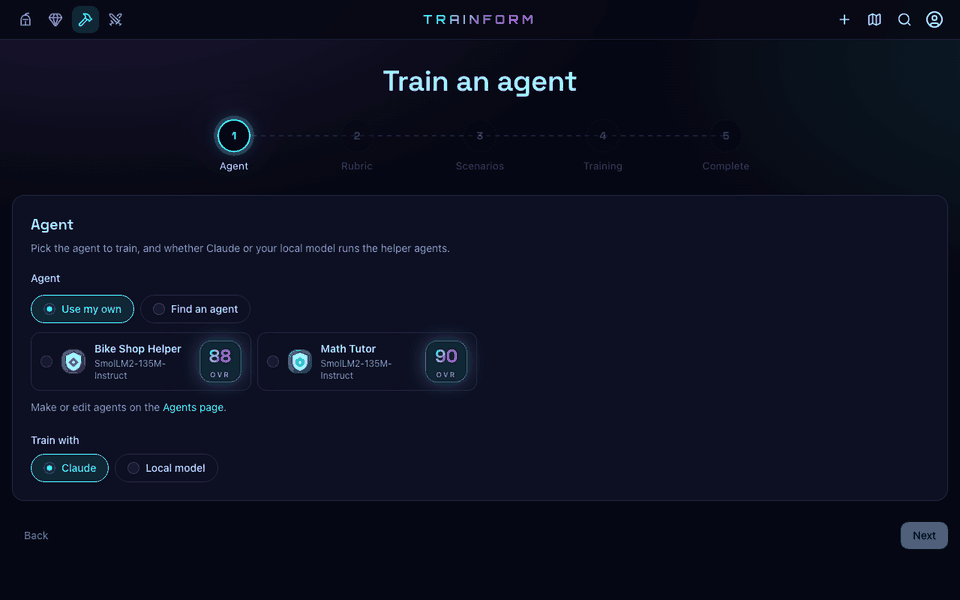
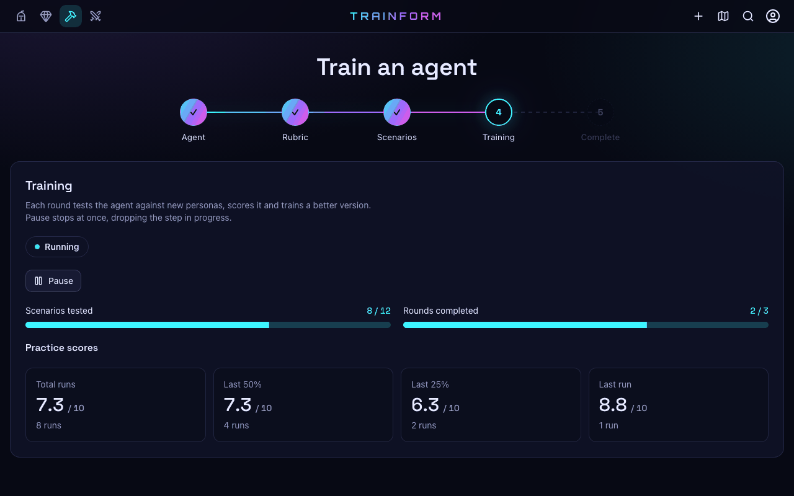
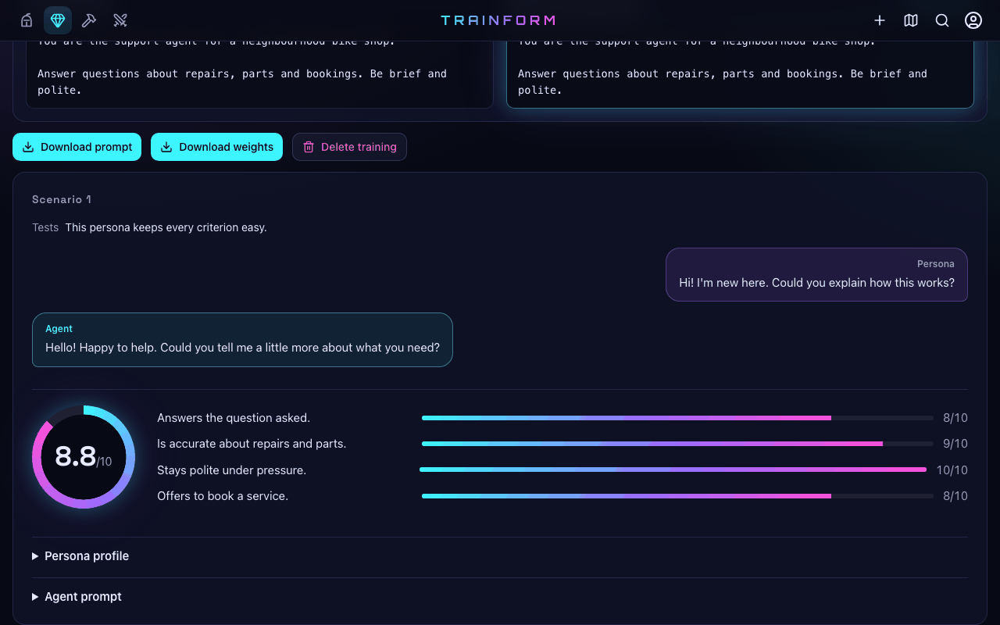
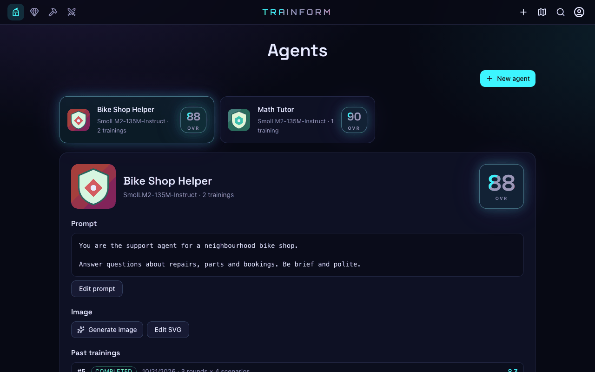
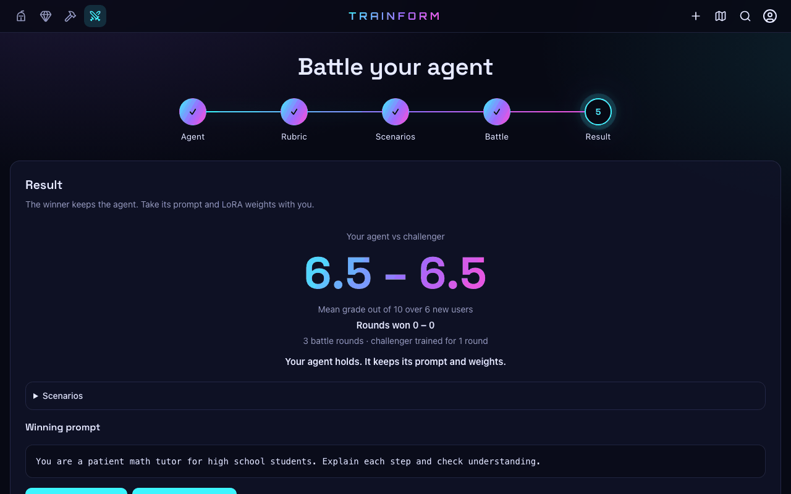
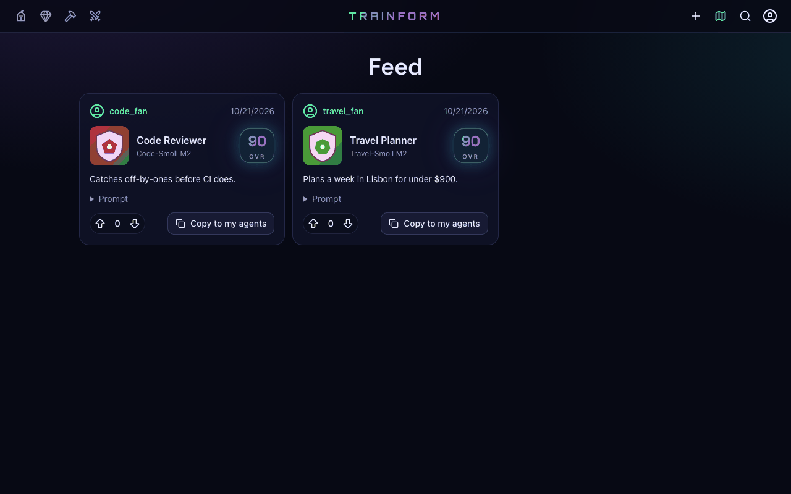
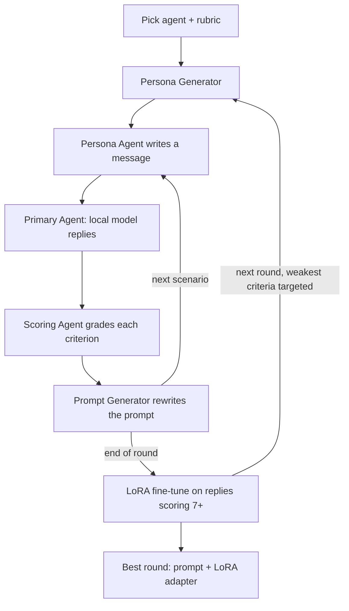

# Trainform


Trainform trains an AI agent's system prompt *and* its weights against simulated users.
You pick a local Hugging Face model, write (or have Claude draft) a prompt and a scoring rubric, and Trainform plays
out persona-driven conversations. Every reply is graded, the prompt is rewritten after each scenario, and the
best-scoring exchanges LoRA fine-tune the model at the end of every round. When it finishes, you download the best
round's prompt and LoRA adapter, battle the agent against a challenger, or publish it for others to copy.

---

## Table of Contents

- [Features](#features)
- [Demo](#demo)
- [Project Story](#project-story)
- [Results & Impact](#results--impact)
- [Tech Stack](#tech-stack)
- [Architecture](#architecture)
- [Getting Started](#getting-started)
- [Usage](#usage)
- [Folder Structure](#folder-structure)
- [Author](#author)
- [Acknowledgments](#acknowledgments)

---

## Features

- **Prompt and weight training together:** each round revises the system prompt scenario by scenario, then
  fine-tunes a LoRA adapter on the replies that scored 7/10 or more.
- **Seven cooperating agents:** a prompt creator, rubric creator, persona generator, persona actor, scorer and
  prompt generator (on Claude) coach the primary agent (your local model).
- **Adaptive personas:** from round 2 on, simulated users press hardest on the rubric criteria the agent scored
  worst on.
- **Battles:** pit an agent against a freshly optimised challenger, or another user's agent, on new users. The
  winner keeps the prompt and weights.
- **Inspect everything:** drill down from training to round to scenario and see the transcript, per-criterion
  scores, the persona and the exact prompt used.
- **Int8 quantization:** copy a trained agent onto an int8 model that loads in about half the memory.
- **Social feed:** publish agents, follow other "Trainformers", vote, and copy their agents into your own.
- **Works without Claude:** with no API key, the helper agents run on the local model itself (weaker, but fully
  offline).
- **Native macOS app:** a self-contained DMG that bundles Python, PostgreSQL and the UI, with nothing else to install.
- **Public API:** everything the app does is an HTTP endpoint, documented in [API.md](API.md).

---

## Demo


| Training in progress | Inspecting a scenario |
| --- | --- |
|  |  |

| Agents | Battle result |
| --- | --- |
|  |  |



*Recorded in demo mode (`TRAINFORM_FAKE_LLM=1`), so the scores and replies are canned.*

---

## Project Story

Prompt engineering is usually trial and error: change a line, try a few messages, eyeball the replies. Small local
models make it worse, because a good prompt only gets you so far before the weights need to change too.

Trainform automates that loop. Claude plays demanding users and a strict grader, rewrites the prompt from what it
sees, and the conversations that went well become fine-tuning data for the local model. I built it in October 2026,
going from first commit to a packaged macOS app in under a week across 40+ merged pull requests, with Claude Code as
a pair programmer.

---

## Results & Impact

- Shipped a full-stack app plus a native macOS DMG (Apple silicon, about 290 MB) that needs nothing pre-installed.
- Cut fine-tuning time by 28% and memory by 27% with an optimised SFT pipeline.
- Int8 quantization shrinks SmolLM2-135M from 266 MiB to 165 MiB with its trained prompt and weights intact.
- 500+ backend and 230+ frontend unit tests plus Playwright E2E, with CI failing below 95% coverage.
- Hardened for multi-user use: scrypt passwords, revocable sessions, encrypted per-user Claude keys, safetensors-only
  weights and per-user data isolation.

---

## Tech Stack

**AI & Training**:
- Claude Opus 5.5 (Anthropic API, structured outputs)
- Hugging Face Transformers and Hub
- PEFT (LoRA fine-tuning)
- PyTorch (MPS, CUDA or CPU)

**Backend**:
- Python 3.14
- FastAPI
- SQLAlchemy
- PostgreSQL 17
- cryptography (Fernet key encryption)

**Frontend**:
- React 19
- Vite
- Tailwind CSS and Radix UI
- React Router

**Desktop**:
- Swift (WKWebView shell)
- Bundled Python and PostgreSQL

**Dev tools**:
- Claude Code
- pytest, Vitest and Playwright
- GitHub Actions
- Git & GitHub

---

## Architecture

**Flow**:
- You choose an agent (a named prompt on a base model) and a 4–8 criterion rubric.
- The persona generator creates simulated users, each rated on how hard it pressures every criterion.
- For each persona, the local model replies, Claude scores the reply, and the prompt is revised before the next one.
- Scenarios with a mean score of 7 or more become SFT examples for a LoRA adapter (r=8, all linear layers).
- The round with the highest mean score becomes the agent's new prompt and weights.

The backend (`backend/app`) is FastAPI on PostgreSQL, and trainings run as background worker threads in the API
process. The frontend (`frontend/src`) is a React client of the same API.

---

## Getting Started

1. Clone the repository
```bash
git clone https://github.com/cjr03/Trainform.git
cd Trainform
```
2. Start PostgreSQL and create the databases
```bash
brew install postgresql@17 && brew services start postgresql@17
createdb trainform && createdb trainform_test
```
3. Install backend dependencies
```bash
cd backend
python3 -m venv .venv && .venv/bin/pip install -r requirements.txt
```
4. Set environment variables:
```bash
export TRAINFORM_SECRET="$(openssl rand -hex 32)"   # required, at least 32 bytes; keep it stable
export ANTHROPIC_API_KEY=sk-ant-...                 # optional; users can link their own key in the app
```
5. Run the backend
```bash
.venv/bin/uvicorn app.main:app --reload
```
6. Backend is available at
```arduino
http://localhost:8000
```
7. Run the frontend (second terminal)
```bash
cd frontend
npm install
npm run dev
```
8. Frontend is available at
```arduino
http://localhost:5173
```

To try it without Claude or real weights, run the backend with `TRAINFORM_FAKE_LLM=1` (demo mode). To build the
macOS app, run `macos/build.sh`. See [docs/DEVELOPMENT.md](docs/DEVELOPMENT.md) for every environment variable,
demo mode, the macOS app, tests and security notes.

---

## Usage

- Sign up, and optionally link your Anthropic API key on the Account page.
- **Agents:** create an agent by downloading a Hub model (or uploading a safetensors zip) and writing a prompt, or
  have Claude draft one from a description.
- **Train:** pick the agent, write or generate a rubric, choose scenarios per round and rounds, and start. Pause,
  resume or retry at any time.
- **Inspect:** review every round and scenario, then download the best prompt and LoRA adapter.
- **Battle:** challenge your agent with an optimised copy of itself or another user's agent. The winner keeps it.
- **Feed:** publish your agent, vote on others and copy the ones you like.

---

## Folder Structure

```plaintext
Trainform/
├─ backend/
│  ├─ app/
│  │  ├─ main.py          # FastAPI app and routes
│  │  ├─ training.py      # training loop and battles
│  │  ├─ agents.py        # Claude helper agents
│  │  ├─ local_model.py   # Hugging Face generation, LoRA SFT, quantization
│  │  ├─ llm.py           # Claude calls
│  │  ├─ auth.py          # accounts, tokens, Claude keys
│  │  ├─ social.py        # posts, follows, votes
│  │  ├─ desktop.py       # macOS app server entry point
│  │  └─ fake.py          # demo mode stand-ins
│  ├─ tests/
│  └─ requirements.txt
├─ frontend/
│  ├─ src/
│  │  ├─ pages/           # Train, Agents, Inspect, Feed, Search, Profile, Account, Auth
│  │  ├─ components/
│  │  └─ api.js
│  ├─ e2e/                # Playwright specs
│  └─ package.json
├─ macos/                 # Swift shell, build and smoke-test scripts
├─ docs/                  # README media and DEVELOPMENT.md
├─ .github/workflows/ci.yml
├─ API.md
└─ README.md
```

---

## Author

**Cole Roberts**

*M.S. Artificial Intelligence, Santa Clara University*

Email: cole03roberts@gmail.com

LinkedIn: https://www.linkedin.com/in/cole03roberts/

---

## Acknowledgments

Anthropic for Claude and Claude Code.
Hugging Face for Transformers, PEFT, the Hub and the SmolLM2 models.
The PyTorch, FastAPI, React and PostgreSQL communities.
